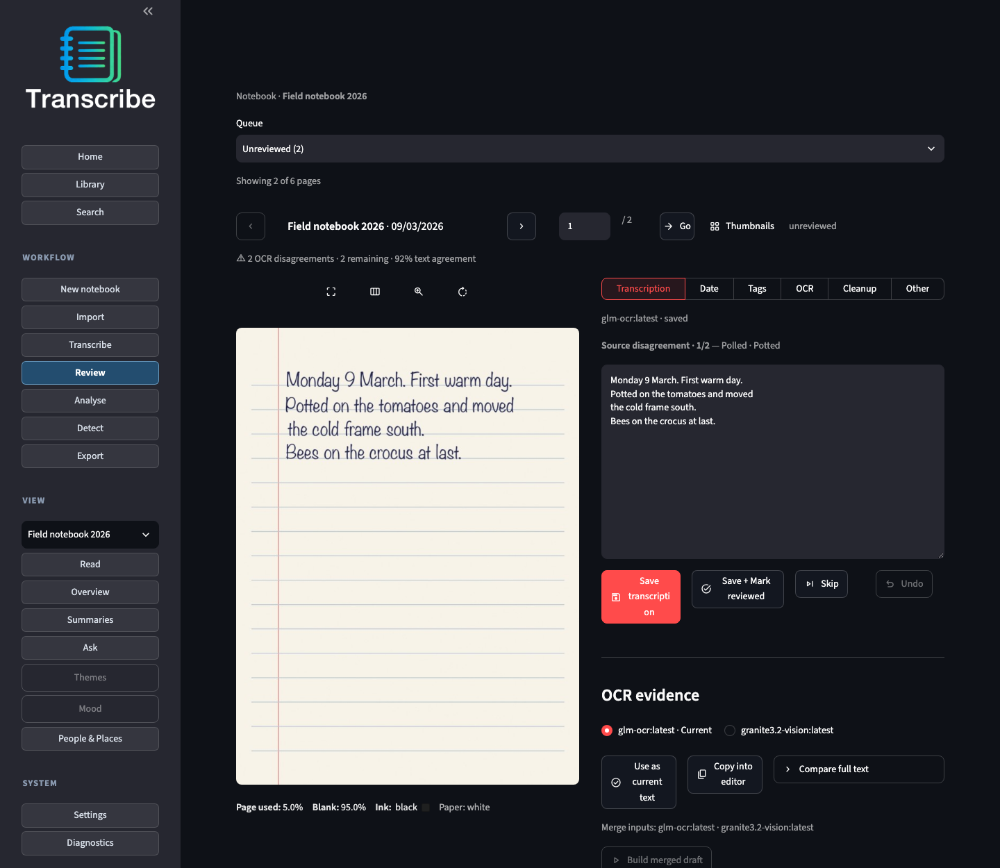
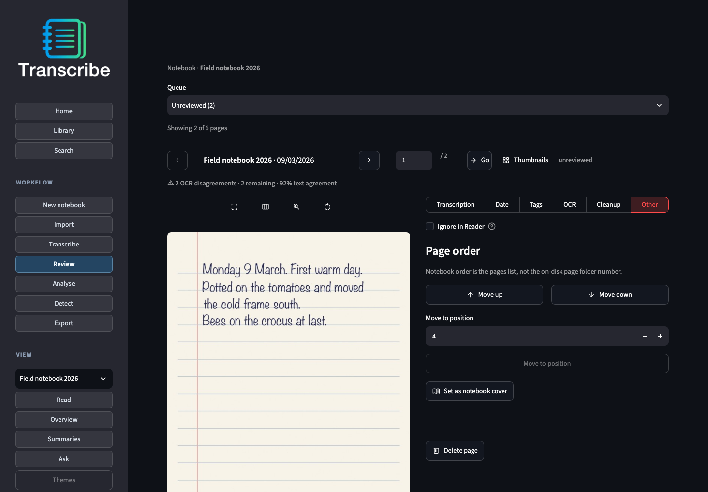

# OCR and transcription

Read notebook pages with a local Ollama vision model, then correct the text
beside the scan.

First-time path: [user guide](../user_guide.md). Model caveats:
[known limitations](../known_limitations.md). Choosing a tag:
[model matrix](ocr_model_matrix.md).

## This notebook

**UI:** **Workflow → Transcribe** → Target **This notebook** → pick a vision
model → optional **Clean OCR with a text model** → Start.

Open **Model information** under the picker for family, size, and OCR-fit notes.
Vision pickers list OCR-appropriate models only (thinking tags, text-only tags,
and broken loaders are hidden). Prefer OCR-oriented tags over general VLMs.

Matching pages are skipped when the same model already succeeded. Settings saved
mid-job apply to the **next** job. Cleanup failures keep the raw OCR and do not
fail the page. Whitespace-only output is failed and does not overwrite a prior
reading.

After **3 consecutive timeouts** or **1 fatal model-load** error, remaining pages
for **that** model are skipped so a bad tag does not burn the notebook.

**CLI:**

```bash
./transcribe.sh cli models
./transcribe.sh cli run "$TRANSCRIBE_PROJECTS_DIR/my-notebook" --model glm-ocr
# force re-OCR: add --force
```

## Review after OCR

**Review** is the work queue (unreviewed, empty text, failures, date approval).
Scan on the left; one lane at a time on the right: **Transcription**, **Date**,
**Tags**, **OCR**, **Cleanup**, **Other**.



- **Transcription** — edit the text. **OCR evidence** lists each attempt; copy one
  into the editor or make it current. **Source disagreement** steps through
  differing words and lets you take either reading or type a correction.
  **Accept proposal** / **Reject proposal** / **Edit proposal** appear when a
  second-pass cleanup exists (Visual **Cleanup** stays declutter). A later OCR
  reading that is far from a saved correction shows a read-only banner. **Apply**
  on a confirmed spelling changes one occurrence in the editor; Save is still
  required.
- **Date** — approve or set the page date. **Move to date cluster** appears when
  the date breaks notebook order.
- **OCR → Re-run OCR** — this page, all pages, or pages not marked reviewed
- **Rank and merge** — build a merged draft from existing readings
- **Cleanup** — re-apply visual declutter (scanner beds, white gutters, corner
  wedges, dark binding gutters, edge shadows, lid slivers — v5) without re-running OCR
- **Other** — **Bookmark**, **Page note**, **Unsure**, **Kept scan**, **Do not OCR
  this page**, **Confirmed spellings**, **Ignore in Reader**, **Page order**,
  notebook cover, delete page

Moving to another page with unsaved changes asks you to **Stay** or
**Discard & leave**.

### Page order

Notebook order is the notebook's page list. The folder number on disk is only a
locator and never changes, so moving a page does not rename or copy files. Use
**Other → Page order** (**Move up**, **Move down**, **Move to position**), the
same controls beside **Thumbnails**, or **Date → Move to date cluster**. Dates
that were only inferred are re-inferred after a move; dates you approved are
kept. Reorder is refused while OCR or analysis is running on the notebook.



```bash
./transcribe.sh cli pages reorder "$TRANSCRIBE_PROJECTS_DIR/my-notebook" PAGE_ID_1 PAGE_ID_2 …
./transcribe.sh cli pages move-to-date-cluster "$TRANSCRIBE_PROJECTS_DIR/my-notebook" PAGE_ID
```

Walkthrough with pictures: [workflow tour](../workflows.md#fixing-page-order).

**Reading** is the same pages chronologically, read-only. On Reading or Library,
**Compare in Review** opens the workbench when several OCR attempts exist.

Layout notes: [ocr review workbench](../dev/ocr_review_workbench_plan.md).

## Compare models

**UI:** **Compare models** (multi-select) → Start (runs in the background).
Vision-phase cleanup defaults **off**. Rank and an optional **merged draft** use
the text model.

If two or more models already have text on disk, **Rank and merge existing OCR**
on Transcribe or Review builds a draft without re-running vision.

**CLI:**

```bash
./transcribe.sh cli multipass "$TRANSCRIBE_PROJECTS_DIR/my-notebook" \
  --model glm-ocr --model granite3.2-vision --text-model qwen2.5:7b
```

Some tags use a model recipe (DeepSeek-OCR freezes a short prompt; glm-ocr and granite overlay sampler options). Edit under **Settings → Models** — [model recipes](ocr_model_recipes.md).

## Notebook OCR settings

Per-notebook overrides live under **Review → OCR** and **Transcribe → Advanced**.
Workspace defaults seed new notebooks. Changes apply to the **next** job.

### When setting a notebook default

What happens when you **Prefer** an OCR attempt (or when a merged draft
auto-activates).

| UI label (Review) | Behaviour |
|-------------------|-----------|
| **Notebook default = current text** (default) | Prefer updates both the notebook default and the text you see |
| **Notebook default only (stats / fine-tune)** | Records a favourite model without changing current text |
| **Notebook default + current, with edit gate** | Like the default, but asks before replacing a human edit |

### Seed transcription from merged draft after multipass

**On** (default): the merged draft becomes current text and seeds Review when
there is no edit. **Off**: rank and draft still run, but you activate the draft
yourself.

CLI: omit `--no-auto-composite` (default on) or pass `--no-auto-composite`.

## Batch OCR

**UI:** **Workflow → Transcribe → Batch** (also after Import → Batch via
**Transcribe imported notebooks**). Single-model or compare across notebooks;
live progress.

```bash
./transcribe.sh cli bulk-run pending --model glm-ocr
./transcribe.sh cli bulk-run import-run <import_run_id> --model glm-ocr
./transcribe.sh cli bulk-run pending --model vision-a --model vision-b --text-model qwen2.5
./transcribe.sh cli bulk-run status|resume <ocr_run_id>
# Optional local MLX sidecar (feat/paddleocr-mlx; not overnight Nightshift):
# transcribe bulk-run notebooks "$NB" --provider paddleocr \
#   --base-url http://127.0.0.1:8112 --model PaddleOCR-VL-1.6
```

## Related

- Settings / preprocess seed: [settings.md](settings.md)
- Model recipes: [ocr_model_recipes.md](ocr_model_recipes.md)
- Local probe matrix: [ocr_model_matrix.md](ocr_model_matrix.md)
- Import / bulk import: [user_guide.md](../user_guide.md#bulk-import-and-batch-jobs)
- Docker Ollama URL: [docker.md](docker.md)
- Contracts: [page-result](../contracts/page-result.md) · [ocr-multipass](../contracts/ocr-multipass.md) · [ocr-preference](../contracts/ocr-preference.md) · [ocr-batch-run](../contracts/ocr-batch-run.md)
