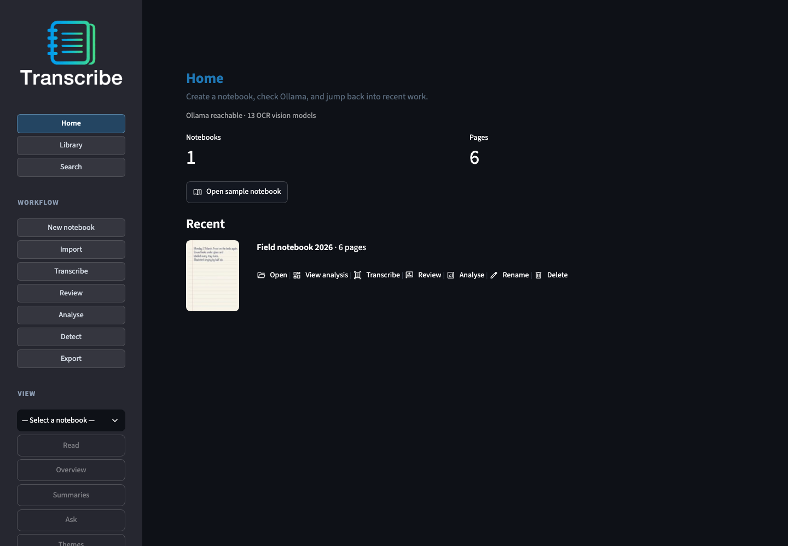
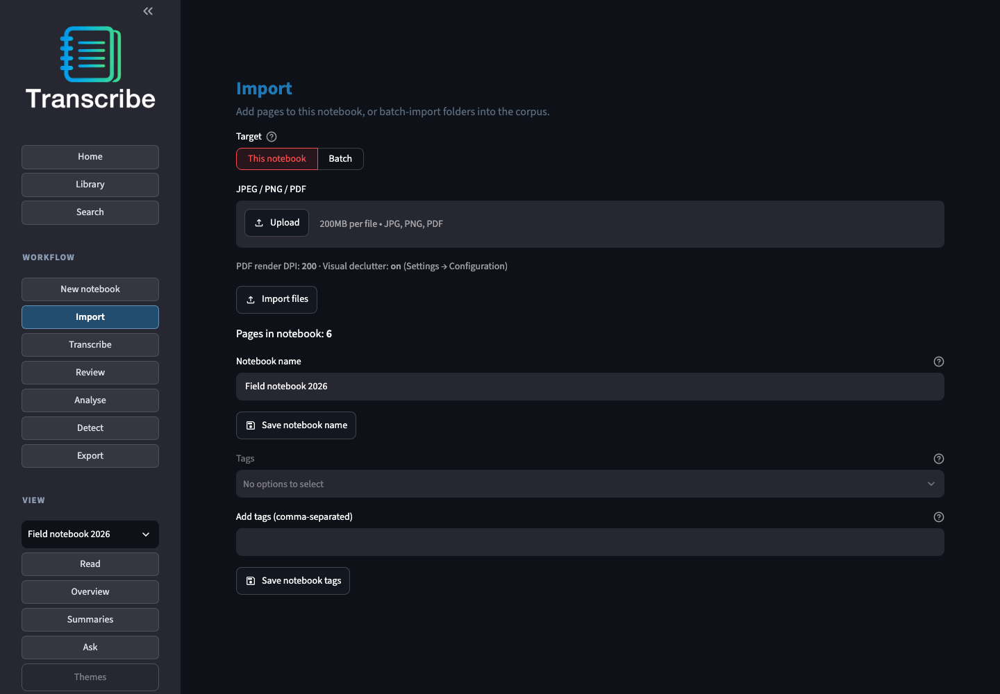
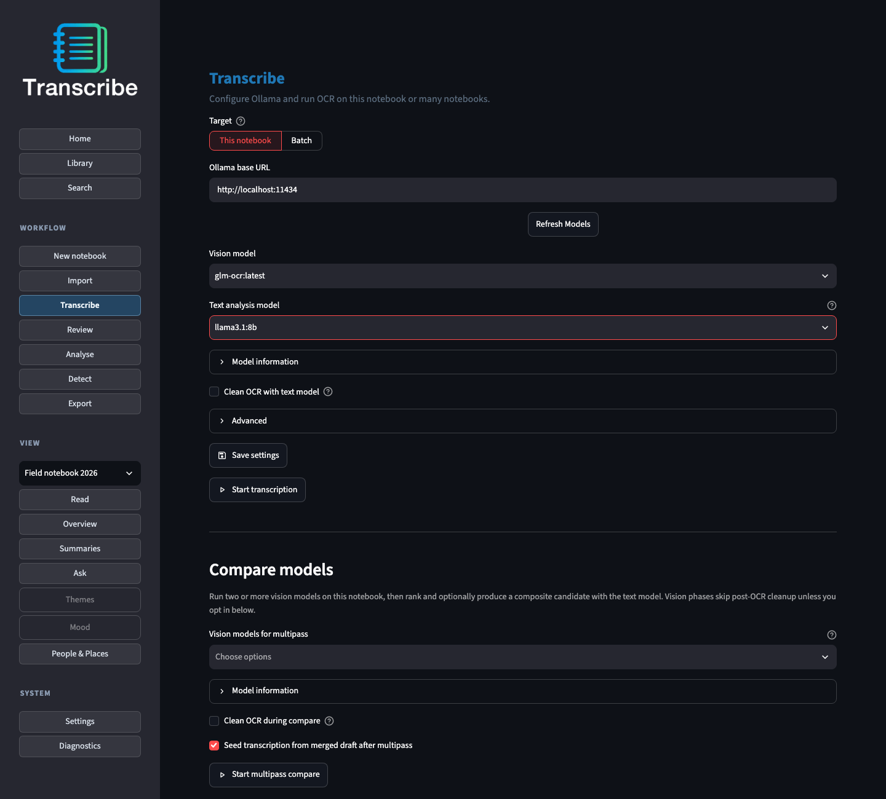
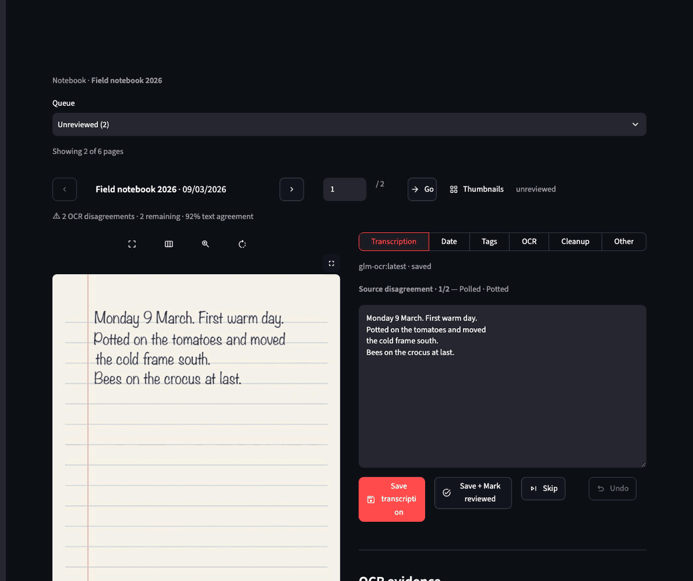
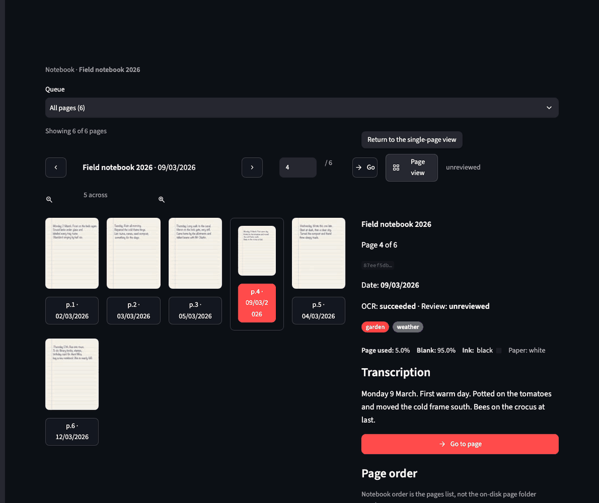
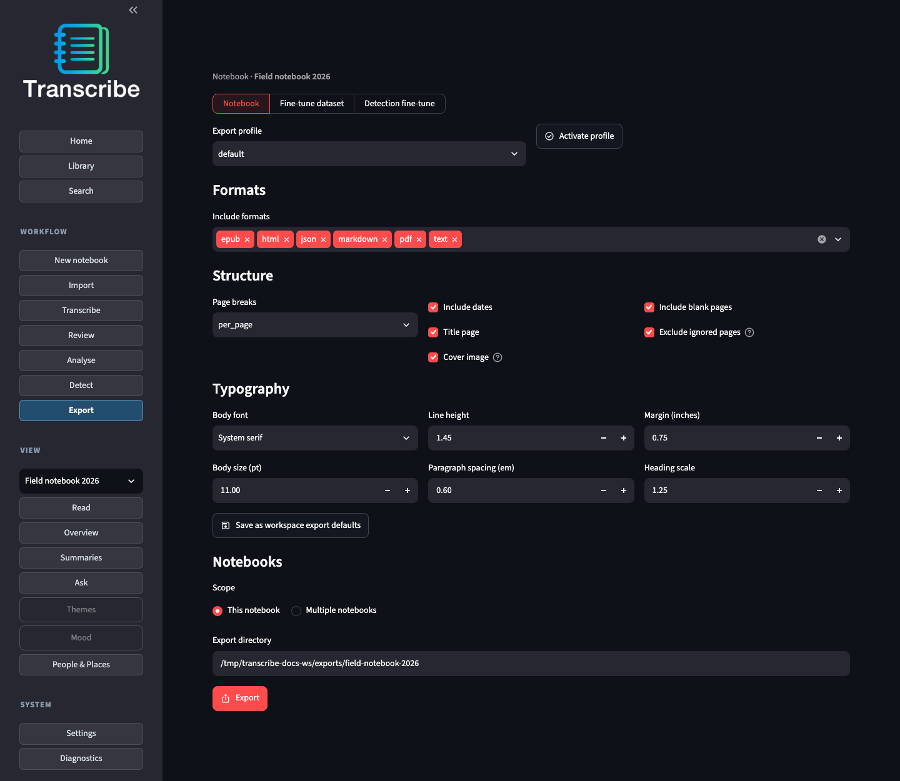
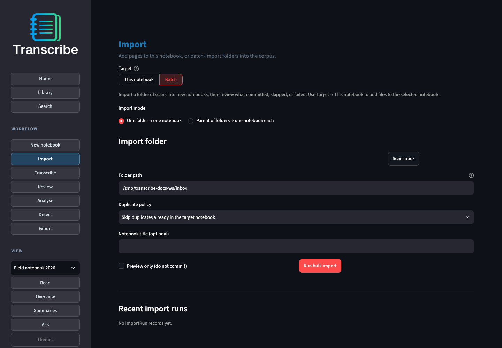

# User guide

Import scans → transcribe with a local vision model → correct the text beside
the page → optionally analyse → export.

**New here?** [First notebook in about 15 minutes](runtime/first_notebook.md)
(Docker, port **8510**).

Product framing: [PRODUCT.md](PRODUCT.md). This page is the golden path in the
UI. CLI one-liners sit under each step; flags and batch jobs live in the
runtime guides. Prefer pictures? [Workflow tour](workflows.md) walks the same
path with screenshots and short GIFs.

## From a scan to a readable notebook

1. Create a notebook: **Workflow → New notebook**, or on **Home** click
   **Open sample notebook** (pre-seeded text for an offline Analyse demo).
2. Import JPEG, PNG, or PDF pages: **Workflow → Import**.
3. Transcribe: **Workflow → Transcribe**, pick an OCR-friendly vision model, start.
4. Correct: **Workflow → Review**, fix the text beside the scan.
   Optionally **Ignore in Reader** for uninteresting pages.

Then, if you want themes and summaries: **Workflow → Analyse** with **Balanced**,
then **View → Overview**.

## Common workflows

| Job | Where |
|-----|--------|
| Open the sample notebook | Home → **Open sample notebook** |
| Import and transcribe a notebook | This page, then [OCR](runtime/ocr.md) |
| Review and correct a page | [OCR — Review](runtime/ocr.md#review-after-ocr) |
| Fix a page that is out of order | [Fix page order](#fix-page-order) |
| Ignore pages in Reading | Review → **Ignore in Reader**; Reader can **Show ignored** |
| Analyse a notebook | [Analysis](runtime/analysis.md) |
| Detect poetry, lists, names, … | [Detect](runtime/analysis.md#detect) |
| See each screen | [Workflow tour](workflows.md) |
| Export Markdown / HTML / PDF | [Export](runtime/export.md) |
| Export OCR or detection fine-tune packs | [Export — Fine-tune](runtime/export.md#fine-tune-export) |

## 1. Create or open a notebook

**UI:** pick an existing notebook from the sidebar, **Workflow → New notebook**,
or **Home → Open sample notebook**. **Open sample** (Home or New notebook)
installs a short placeholder notebook with text already filled in, so you can
try Reading and Analyse without OCR. First visit opens **Home**. Rename later
from **Library** or **Workflow → Import**.



In **Library**, click a cover or the **Open** button under it to open that notebook.

**CLI:**

```bash
./transcribe.sh cli init "$TRANSCRIBE_PROJECTS_DIR/my-notebook" --title "Travel 2024"
```

On-disk layout: [contracts/project-on-disk.md](contracts/project-on-disk.md).

## 2. Import

Supported inputs: JPEG, PNG, PDF (unencrypted). PDFs become one PNG per page.

**UI:** select a notebook → **Workflow → Import** → Target **This notebook** →
upload → Import files. A live panel shows per-file status.

Visual declutter defaults **on**. It crops scanner beds, stark-white gutters,
corner wedges, dark binding gutters, and edge shadows. It is conservative, so
many pages are left alone. Toggle or re-apply under
**Settings → Configuration → Import**, or use **Review → Cleanup** for one page
(neither re-runs OCR). Existing notebooks only change when you re-apply.



**CLI:**

```bash
./transcribe.sh cli import "$TRANSCRIBE_PROJECTS_DIR/my-notebook" ./scan.pdf --dpi 200
```

Several folders at once: [Bulk import](#bulk-import-and-batch-jobs).

## 3. Transcribe

You need a running Ollama server and an OCR-friendly **vision** model. Prefer
OCR-oriented tags over general VLMs. Thinking models such as `gemma4` are hidden
from the picker because they often return empty text.

**UI:** **Workflow → Transcribe** → Target **This notebook** → choose a vision
model → optional **Clean OCR with a text model** → Start transcription. Open
**Model information** under the picker for size and OCR-fit notes.



Jobs show live per-page progress. After repeated timeouts or a model that will
not load, remaining pages for **that** model are skipped so a bad tag does not
burn the whole notebook.

**CLI:**

```bash
./transcribe.sh cli models
./transcribe.sh cli run "$TRANSCRIBE_PROJECTS_DIR/my-notebook" --model glm-ocr
```

Compare two models, or transcribe many notebooks: [OCR](runtime/ocr.md).
Caveats: [known limitations](known_limitations.md) · [model matrix](runtime/ocr_model_matrix.md).

## 4. Review

**Review** is the work queue for the open notebook: scan on the left, one lane
at a time on the right (**Transcription**, **Date**, **Tags**, **OCR**,
**Cleanup**, **Other**).

Approve or edit the text, then **Save + Mark reviewed** to move on. If two OCR
attempts disagree, **OCR evidence** shows both and **Source disagreement** steps
through the differing words. Moving to another page with unsaved changes asks
you to **Stay** or **Discard & leave**. Mark
uninteresting pages **Ignore in Reader** so Reading skips them by default
(Settings → Configuration → Reading controls the default; Reader can
**Show ignored**). The same pages are omitted from exported Markdown, HTML,
PDF, EPUB, and text by default; JSON export keeps them. **Thumbnails** switches
Review or Reading to a page grid;
click the page button under a thumb to open that page. **Reading** is the same
pages in chronological order, read-only. **Library** is the cover gallery;
**Search** finds text across notebooks.



Workbench detail, keyboard shortcuts, and re-run OCR: [OCR — Review](runtime/ocr.md#review-after-ocr).

### Fix page order

Notebook order is the notebook's page list, not the folder number on disk, so
moving a page never renames files. In **Review → Other → Page order** use
**Move up**, **Move down**, or **Move to position**. When a page's date breaks
the order, **Review → Date → Move to date cluster** places it after the pages
with the same confirmed date (or in date order if there are none). **Thumbnails**
offers the same controls beside the grid; dragging thumbnails is a bonus where
the browser allows it. Reorder is refused while OCR or analysis is running.



```bash
./transcribe.sh cli pages reorder "$TRANSCRIBE_PROJECTS_DIR/my-notebook" PAGE_ID_1 PAGE_ID_2 …
./transcribe.sh cli pages move-to-date-cluster "$TRANSCRIBE_PROJECTS_DIR/my-notebook" PAGE_ID
```

```bash
./transcribe.sh cli status "$TRANSCRIBE_PROJECTS_DIR/my-notebook"
```

## 5. Analyse (optional)

After pages have text, open **Workflow → Analyse**:

1. Choose **Quick** / **Balanced** / **Thorough** / **Custom**. First-time: keep **Balanced**.
2. Optionally add an Ask-notebook question (Grounded, RAG, or Both once RAG is enabled in Settings → Analysis).
3. Run analysis. On success, open **View → Overview**.

**View** pages (Overview, Themes, Mood, Summaries, People & Places) show charts
and lists, not raw JSON. Mood includes **Moments**; Summaries includes **Ask**.
**Jump to page** opens that page in Reading.

**Workflow → Detect** scans for poetry, lists, quotations, names, and similar.
A running scan can be stopped with **Stop after current window**. Accept or
reject findings; accepted findings can apply page tags. A tag you removed from a
page stays removed until you apply it again.

Need a **text** Ollama model for LLM modules. Deterministic modules work without
one. Presets, batch Analyse, and detector lists: [analysis](runtime/analysis.md).

## 6. Export

**UI:** **Workflow → Export** — pick formats and typography.



Produces JSON, Markdown, plain text, HTML, EPUB, and/or PDF.

```bash
./transcribe.sh cli export "$TRANSCRIBE_PROJECTS_DIR/my-notebook"
```

Formats, anthology, OCR fine-tune, and **detection** fine-tune packages:
[export](runtime/export.md). After training a hand-specific model elsewhere,
the fine-tune export includes a bring-back checklist: [fine-tune export](finetune_export.md).

**1.2 export extras:** under **Page tag filters** you can keep only pages
carrying all of a set of tags, or skip pages carrying any of them (reading
formats only — the notebook JSON always keeps every page). Scope can be a
whole **Collection** (below), and **Custom body font family** names a font
available to the reader instead of the curated list.

## Organise and find (Library & Search)

- **Collections** — Library → **Collections & archived notebooks**: create a
  named shelf, tick its notebooks, rename or delete it. Shelves span
  notebooks; they are not tags.
- **Archive a notebook** — same panel: archived notebooks disappear from
  default Library, Search, and pickers but are never deleted and stay in
  backups. Tick **Include archived notebooks** to see them again.
- **Saved searches** — on Search, run a search, then **Saved searches → Save
  current search**. Applying a saved search re-runs its filters against the
  current notebooks (it stores filters, not results).
- **People & Places filters** — Search and Library accept published-NER
  people/place names: a notebook only matches once Analyse has published
  NER for it.
- **Click a scan** in Reading or Review to view it fullscreen on black;
  Esc or a click closes it.

## Integrity, backup, and settings

- **System → Diagnostics** — workspace health, notebook health when one is selected, a **job timeline** (recent OCR / Analyse / Detect runs), and the local **quality** summary (OCR samples from your Review corrections; nothing is sent anywhere). CLI equivalents: `transcribe workspace-doctor`, `transcribe quality summary`, `transcribe verify-export <export-dir>`.
- **Settings → Configuration → Backup** — full-workspace ZIP. Guide: [backup and restore](backup_and_restore.md).
- **Settings** tabs: Configuration · Analysis · Detection · Tags · Prompts · Interface · Models · Profiles · Export. [Settings](runtime/settings.md).

```bash
./transcribe.sh cli doctor "$TRANSCRIBE_PROJECTS_DIR/my-notebook"
./transcribe.sh cli backup create
```

## Bulk import and batch jobs

Everyday use is one notebook at a time. To ingest a folder of scans, or many
folders as many notebooks: **Workflow → Import** → Target **Batch**. **Scan inbox**
fills the path from `TRANSCRIBE_INBOX_DIR`. Each run reports how many items were
**imported**, **failed**, **duplicated**, or **needs-review** (same file in another
notebook, a changed file with the same name, or work that did not finish). After a
successful import, **Transcribe imported notebooks** opens batch OCR.



**Workflow → Analyse → Batch** runs analysis across a list of notebooks.

Docker users paste **container** paths (`/mnt/inbox`), not host paths.
Details: [docker](runtime/docker.md) · CLI: [public surfaces](public_surfaces.md).

## Privacy

Prefer loopback Ollama (`http://localhost:11434`). A remote host sends page
images off-machine and requires acknowledgement. See [known limitations](known_limitations.md).
